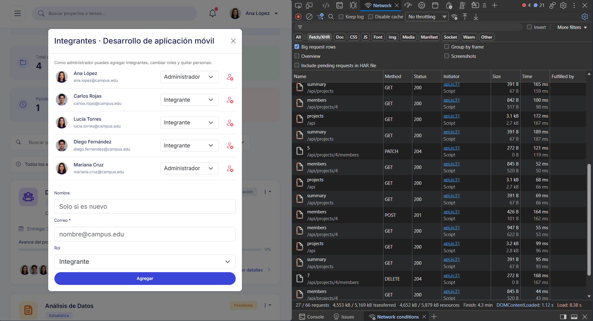
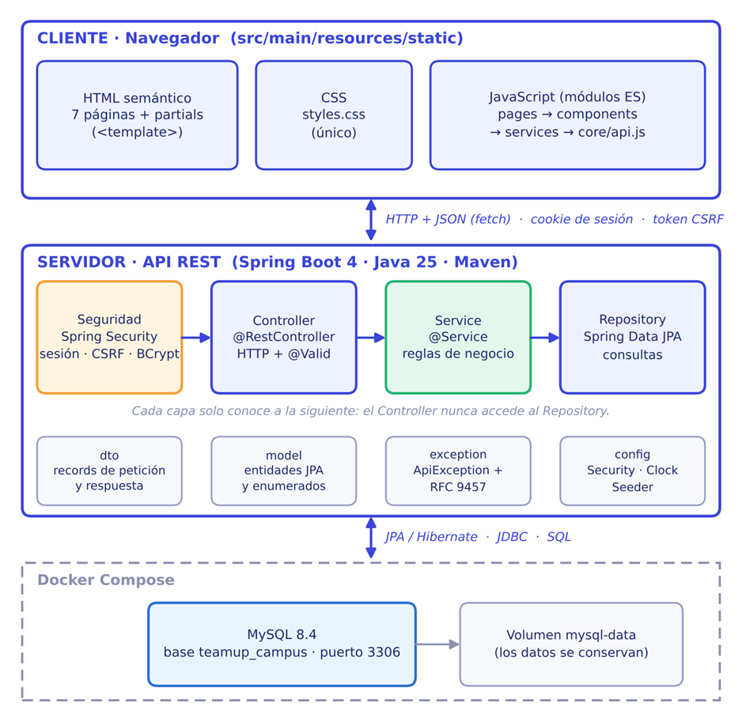

# TeamUp Campus

Plataforma web para **organizar trabajos grupales universitarios**: proyectos, integrantes con roles, tareas con responsables y fechas límite, y un panel de progreso calculado por el servidor.




## Características

- Registro, inicio de sesión y recuperación de contraseña (simulada: no envía correos).
- Proyectos con curso, fecha de entrega y estado; roles de **administrador** e **integrante**.
- Tareas con responsable, prioridad, fecha límite y estado; filtros, búsqueda y paginación.
- Progreso: avance, tareas vencidas, serie semanal, salud del proyecto y avisos.
- Las reglas de negocio y los cálculos viven en el **servidor**; la interfaz solo muestra lo que este decide.

## Tecnologías

| Capa | Tecnología |
|---|---|
| Servidor | Java 25, Spring Boot 4 (MVC, Data JPA, Security, Validation), Maven |
| Base de datos | MySQL 8.4 en Docker (H2 en memoria solo para las pruebas) |
| Cliente | HTML5 semántico, CSS3 (un solo `styles.css`), JavaScript con módulos ES, Bootstrap 5, Chart.js |

## Arquitectura



| Capa | Responsabilidad |
|---|---|
| `controller` | Traduce HTTP: recibe la petición, valida con `@Valid` y devuelve el código HTTP. **Sin reglas de negocio.** |
| `service` | **Reglas de negocio**: permisos, avance, alertas e integrantes (`AuthService`, `ProjectService`, `MembershipService`, `TaskService`, `ProgressService`, `NotificationService`). |
| `repository` | Lee y guarda datos con Spring Data JPA. |
| `model` / `dto` | Entidades de la base de datos / objetos de petición y respuesta (la entidad nunca sale directo a la API). |
| `exception` | Un manejador global devuelve errores uniformes (RFC 9457). |

El cliente no llama a `fetch` desde las páginas: usa los módulos de `js/services` (por ejemplo, `TaskService.setState(id, estado)`), que centralizan las URL, los errores y la redirección a `login.html` cuando no hay sesión.

## Seguridad

- Contraseñas con **BCrypt**.
- Sesión con cookie `HttpOnly` y `SameSite=Lax`.
- Protección **CSRF** (cookie `XSRF-TOKEN` y cabecera `X-XSRF-TOKEN`).
- Todos los permisos se comprueban en el servidor, no en la interfaz.

## Requisitos previos

- [JDK 25](https://adoptium.net/) y [Maven 3.9+](https://maven.apache.org/)
- [Docker Desktop](https://www.docker.com/products/docker-desktop/)
- Puertos libres: **8080** y **3306**

## Cómo ejecutarlo

```bash
# 1) Clonar el repositorio
git clone https://github.com/KathrymOriana/teamup-campus_ep.git
cd teamup-campus

# 2) Levantar la base de datos (MySQL en Docker)
docker compose up -d mysql

# 3) Levantar la API y el cliente
mvn spring-boot:run
```

Abre **http://localhost:8080/login.html**. La primera vez, la API crea las tablas y carga datos de ejemplo.

- **Todo en Docker:** `docker compose --profile app up --build`
- **Detener:** `docker compose down` (conserva los datos) o `docker compose down -v` (los borra).
- Las credenciales de la base de datos (`root` / `root123`) están en `docker-compose.yml` y `application.properties`: son **solo para desarrollo y fines académicos**.

## API REST

Las rutas bajo `/api/**` exigen sesión, salvo login, registro, sesión y recuperación.

| Método y ruta | Descripción |
|---|---|
| `POST /api/auth/register` · `login` · `password-reset` · `GET /api/auth/session` · `me` | Cuenta y sesión |
| `GET /api/courses` | Cursos |
| `GET/POST /api/projects` · `PUT/DELETE /api/projects/{id}` · `GET /api/projects/summary` | Proyectos |
| `GET/POST /api/projects/{id}/members` · `PATCH/DELETE …/members/{userId}` | Integrantes y roles |
| `GET /api/tasks?projectId=` · `POST /api/tasks` · `PUT/DELETE /api/tasks/{id}` · `PATCH /api/tasks/{id}/state` | Tareas |
| `GET /api/progress?projectId=` · `GET /api/notifications` | Progreso y avisos |

**Códigos:** 

`200` correcto · `201` creado · `204` sin contenido · `401` sin sesión · `403` sin permiso · `404` no existe · `409` duplicado · `422` validación o regla de negocio.

## Estructura del proyecto

```
teamup-campus/
├── docker-compose.yml · Dockerfile · pom.xml
└── src/
    ├── main/
    │   ├── java/com/teamup/api/
    │   │   ├── controller/
    │   │   ├── service/
    │   │   ├── repository/
    │   │   ├── model/
    │   │   ├── dto/
    │   │   ├── exception/
    │   │   └──config/
    │   └── resources/
    │       ├── application.properties
    │       └── static/    CLIENTE: HTML, css/, js/ (core, services, components, pages), partials/, assets/
    └── test/java/com/teamup/api/
```

## Pruebas

```bash
mvn test
```

Usan H2 en memoria: **no necesitan Docker ni MySQL**.

| Prueba | Qué comprueba |
|---|---|
| `ProgressServiceTest` | Porcentajes de avance, tareas vencidas y salud del proyecto. |
| `TaskServiceTest` | Permisos: un ajeno no cambia el estado (403), el responsable sí, y un integrante no asigna tareas a otros. |
| `ApiFlowTest` | De extremo a extremo: 401 sin sesión, login con CSRF, proyectos con avance calculado y rechazo de credenciales inválidas. |

## Licencia

Proyecto académico sin fines comerciales.